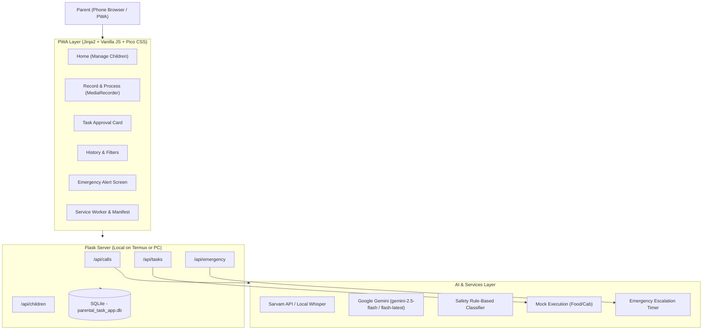

# Developer Guide: LevelUp Parental Task Delegation PWA

Welcome to the Developer Guide for the **AI-Powered Parental Task Delegation App (LevelUp PWA)**. This document provides an in-depth breakdown of the project architecture, directory structure, data models, services, and API contracts.

---

## Architecture Overview



The system is designed as a standalone **Progressive Web App (PWA)** powered by a lightweight Python/Flask backend that can run directly inside **Termux on an Android phone** or on any standard Linux/macOS/Windows host.

---

## Directory Structure

```text
child_parent_system/
├── backend/
│   ├── api/
│   │   ├── calls.py         # Audio upload & transcription/intent processing
│   │   ├── children.py      # Child profile CRUD & task association
│   │   ├── emergency.py     # Distress alerts, parent acknowledgement & timer
│   │   └── tasks.py         # Task listing, detail view & decision approval
│   ├── services/
│   │   ├── ai_service.py     # Dual STT + Gemini intent classification & fallback
│   │   ├── mock_execution.py # Simulated Zomato/Uber order placement
│   │   └── voice_biometrics.py # Speaker embedding placeholders
│   ├── static/
│   │   ├── css/app.css      # Custom mobile-first theme rules
│   │   ├── js/app.js        # Global utilities, Service Worker & emergency banner
│   │   ├── icons/           # PWA icons (192x192, 512x512)
│   │   ├── manifest.json    # Web app manifest for standalone mobile installation
│   │   └── sw.js            # Service worker caching strategy
│   ├── templates/
│   │   ├── base.html        # App shell with bottom navigation
│   │   ├── index.html       # Child management & pending tasks dashboard
│   │   ├── record.html      # Audio recording / upload & live processing card
│   │   ├── task.html        # Detailed approval view with decision buttons
│   │   ├── history.html     # Past task execution log with status filters
│   │   └── emergency.html   # Full-screen distress screen
│   ├── database.py          # SQLAlchemy engine and session provider
│   ├── main.py              # Application entry point & template route bindings
│   ├── models.py            # SQLAlchemy database schemas
│   ├── schemas.py           # Pydantic validation schemas
│   ├── requirements.txt     # Python dependencies
│   └── .env                 # Environment variables (API keys, ports)
├── planning/                # Conceptual planning documents & masterplan
├── DEVELOPER_GUIDE.md       # Technical architecture (this document)
├── KNOWN_LIMITATIONS.md     # Engineering constraints and trade-offs
├── README.md                # Project overview and quick start
├── RUN_INSTRUCTIONS.md      # Development and local running guide
└── TERMUX_SETUP.md          # Step-by-step Termux on Android instructions
```

---

## 1. Backend Layer (`/backend`)

### Core Entry Point (`main.py`)
- Loads environment variables via `python-dotenv`.
- Creates SQLite database tables upon launch.
- Registers API blueprints under `/api/*`.
- Renders Jinja2 HTML templates for frontend pages.
- Exposes health-check endpoint at `/api/health`.

### Database & ORM (`database.py`, `models.py`)
Built on SQLite with thread-safe connection pooling:
- **`Parent`**: Master account info, email, and authentication PIN.
- **`ChildProfile`**: Child name, phone number, age, auto-approval thresholds, and emergency backup contact.
- **`TaskRecord`**: Logs audio call UUID, transcript, plain-language summary, extracted metadata (cost, destination, restaurant), and parent decision status (`pending`, `approved`, `declined`, `executed`, `failed`).
- **`EmergencyEvent`**: Tracks trigger reasons, transcript excerpts, location coordinates, acknowledgement status, and backup contact notifications.

---

## 2. AI & Intent Pipeline (`services/ai_service.py`)

### Speech-to-Text (STT) Cascade
1. **Primary**: Sarvam AI API (`https://api.sarvam.ai/speech-to-text-translate`) for fast transcription with Indian accent and regional language support.
2. **Fallback**: Local Whisper (`whisper.load_model('base')`), lazy-loaded on demand to ensure zero memory overhead if not installed.

### Intent Extraction & Emergency Safety Net
Intent classification uses a resilient multi-tier cascade:
1. **Gemini 2.5 Flash**: Parses the transcript into strict JSON matching the `IntentResponse` Pydantic model.
2. **Gemini Flash Latest**: Fallback if primary model encounters temporary API demand spikes.
3. **Safety Rule-Based Classifier**: Operates 100% offline using keyword matching. If distress phrases (`"help me"`, `"hurt"`, `"scared"`, `"stranger"`, `"bleeding"`) are detected, the system immediately flags `is_emergency: True`, bypassing standard task approval.

---

## 3. Frontend PWA (`/templates`, `/static`)

- **Classless Base**: Utilizes [Pico CSS](https://picocss.com/) via CDN — responsive, lightweight (~10KB), requiring no Node.js or bundlers.
- **Bottom Navigation**: Mimics native mobile navigation (`Home`, `Record`, `History`).
- **In-Browser Audio Capture**: `navigator.mediaDevices.getUserMedia()` feeds into `MediaRecorder`, outputting standard WebM/Opus or WAV blobs uploaded via `multipart/form-data`.
- **Installability**: `manifest.json` specifies `"display": "standalone"`, enabling users to add the application directly to their Android launcher from Chrome.
- **Global Emergency Polling**: [`app.js`](file:///home/adithya2007/Desktop/level%20up/child_parent_system/backend/static/js/app.js) polls every 10 seconds for unacknowledged emergencies, raising high-priority web notifications and an app-wide emergency banner.
